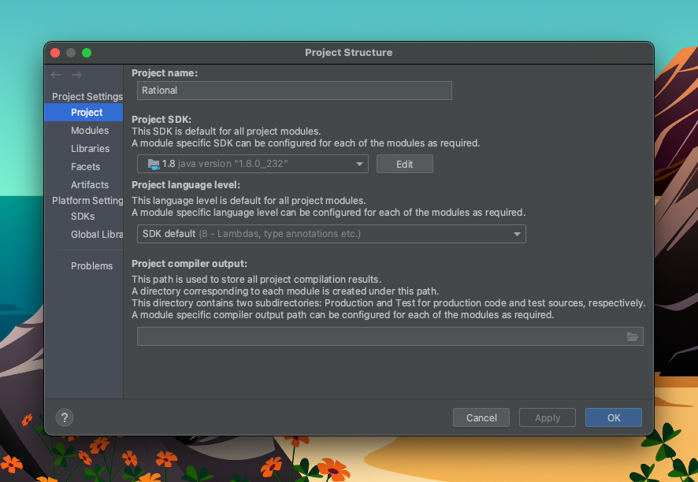

# tdd-rational-exercise

An exercise for practicing Test-Driven Development (TDD) with JUnit.

The project is a small Java program for doing arithmetic on rational numbers
(fractions). The `Rational` class is only partly written. Your job is to
**write the tests first**, then finish the implementation until every test passes.

This exercise is to be done **individually**.

## Project layout

```
.
├── src/main/java/Rational.java      # the class under test (partial implementation)
├── src/test/java/RationalTest.java  # JUnit 4 tests (one example test provided)
└── pom.xml                          # Maven build (JUnit 4.13)
```

## Exercise

1. You need an IDE to work on this exercise. IntelliJ IDEA is recommended. You
   can download it from <https://www.jetbrains.com/idea/download>.

2. Clone this repository to your local machine:

   ```sh
   git clone https://github.com/cragkhit/tdd-rational-exercise.git
   ```

3. Open the project in IntelliJ. When asked which type of project to open,
   select **Maven**. The project targets Java 8, so set the *Project SDK* and
   *Project language level* to 1.8 (**File > Project Structure > Project**).

   

4. Look at the `Rational` class in
   [`src/main/java/Rational.java`](src/main/java/Rational.java). Its partial
   implementation is below.

   ```java
   class Rational {
       long numerator,denominator;

       class Illegal extends Exception {
           String reason;
           Illegal (String reason) {
               this.reason = reason;
           }
       }

       Rational() {
           // to be completed
       }

       Rational(long numerator, long denominator) throws Illegal {
           // to be completed
       }

       // find the simplest form of a Rational number
       private void simplestForm() {
           long computeGCD;
           computeGCD = GCD(Math.abs(numerator), denominator);
           numerator /= computeGCD;
           denominator /= computeGCD;
       }

       // find the greatest common denominator
       private long GCD(long a, long b) {
           if (a%b ==0) return b;
           else return GCD(b,a%b);
       }

       public void add(Rational x) {
           numerator = (numerator * x.denominator) + (x.numerator * denominator);
           denominator = (denominator * x.denominator);
           simplestForm();
       }

       public void subtract(Rational x) {
           // to be completed
       }

       public void multiply(Rational x) {
           // to be completed
       }

       public void divide(Rational x) {
           // to be completed
       }

       public boolean equals(Object x) {
           // to be completed
           return true; // TODO: This needs to be modified.
       }

       public long compareTo(Object x) {
           // to be completed
           return -1; // TODO: this needs to be modified.
       }

       public String toString() {
           // to be completed
           return ""; // TODO: This needs to be modified.
       }

       public static void main(String[] args) {
           System.out.println("This is Rational class.");
       }
   }
   ```

   What each method should do:

   | Method | Expected behaviour |
   | --- | --- |
   | `Rational()` | Creates a rational number with default values. |
   | `Rational(long numerator, long denominator)` | Creates `numerator/denominator`. Throws `Illegal` when the inputs are invalid. |
   | `add(Rational x)` | Sets the current number to `this + x`. |
   | `subtract(Rational x)` | Sets the current number to `this − x`. |
   | `multiply(Rational x)` | Sets the current number to `this × x`. |
   | `divide(Rational x)` | Sets the current number to `this ÷ x`. |
   | `equals(Object x)` | Returns `true` if `x` is equal to the current number, `false` otherwise. |
   | `compareTo(Object x)` | Returns `-1` if the current number is less than `x`, `0` if they are equal, `1` if it is greater. |
   | `toString()` | Returns the number as a string, e.g. `"1/2"`, `"3/4"`. |

5. Write JUnit test cases in `RationalTest` under `src/test/java` to test the
   class above **before** you finish implementing `Rational`. Use the
   *input space partitioning* technique you learned in class to design the
   test cases.

6. `RationalTest` already contains one test case:

   ```java
   import org.junit.After;
   import org.junit.Assert;
   import org.junit.Before;
   import org.junit.Test;

   public class RationalTest {
       Rational r1;
       Rational r2;

       @Before
       public void createRationals() {
           r1 = new Rational();
           r2 = new Rational();
       }

       @Test
       public void testAdd() {
           r1.numerator = 1;
           r1.denominator = 2;
           r2.numerator = 1;
           r2.denominator = 4;
           r1.add(r2);
           Assert.assertEquals(3, r1.numerator);
           Assert.assertEquals(4, r1.denominator);
       }

       @After
       public void clearUp() {
           r1 = null;
           r2 = null;
       }
   }
   ```

7. Run this test by clicking the green arrow next to the method name, then
   check the result.

   

8. Once you have test cases for **all** the public methods of `Rational`,
   finish implementing `Rational`. Writing the tests before the code like
   this is called Test-Driven Development (TDD).

9. Make sure all tests pass and that your implementation of `Rational` is
   complete.

## Running the tests from the command line

```sh
mvn test
```

## Submission

When you have finished every step, zip the project and submit it as your
instructor directs.
